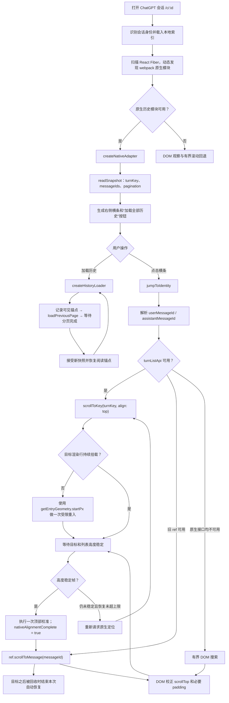
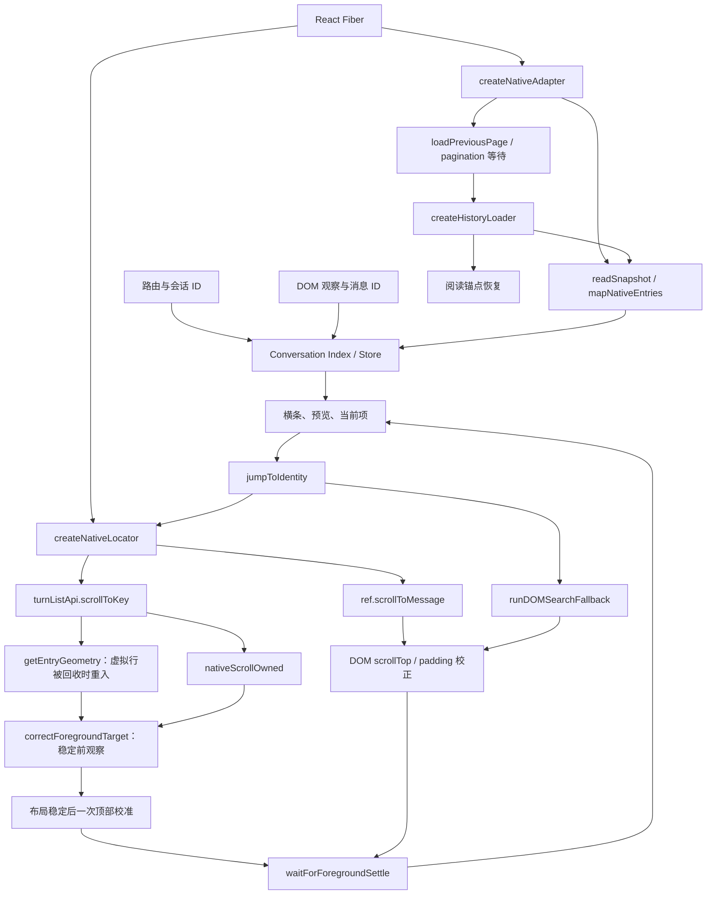

# 历史加载与消息导航架构

最后核对：2026-11-20

本文记录当前工作区中历史加载、右侧横条跳转、ChatGPT 原生定位和后台历史分页的实现方式。测试和源码是实现证据；ChatGPT 的内部 React 接口不是稳定公共契约，升级后需要重新实测。

## 运行逻辑

## 代码与数据流

## 主要模块

- `createHistoryLoader`：逐页调用原生历史加载器，去重游标和快照签名，限制停止、错误和重复分页。见 [userscript](../../chatgpt-conversation-navigator.user.js#L477)。
- `findTarget` / `createNativeLocator`：从当前 React Fiber 中找到会话列表，优先使用新 `turnListApi`，否则使用旧 `ref.scrollToMessage`。新路径会在渲染行被回收后用 `getEntryGeometry.startPx` 做一次受限重入。见 [userscript](../../chatgpt-conversation-navigator.user.js#L2089) 和 [createNativeLocator](../../chatgpt-conversation-navigator.user.js#L2475)。
- `createNativeAdapter`：动态发现 webpack 模块，通过原生 AppScope 读取分页状态和 `loadPrevious`，不直接复制页面 Cookie 或绕过缓存。见 [createNativeAdapter](../../chatgpt-conversation-navigator.user.js#L2665)。
- `deriveHistoryControlView`：只在原生状态确认还有旧页、正在加载或可重试时显示历史按钮。见 [deriveHistoryControlView](../../chatgpt-conversation-navigator.user.js#L4937)。
- `correctForegroundTarget`：`nativeScrollOwned` 为真时在布局稳定前只读取几何；稳定后允许一次顶部校准。完成校准后目标再被回收就结束自动恢复。见 [correctForegroundTarget](../../chatgpt-conversation-navigator.user.js#L8378)。
- `locateNativeSearchTarget` / `recoverForegroundTarget`：串行化原生定位，恢复次数上限为 2，避免目标行每次回收都重新触发 `scrollToKey`。见 [locateNativeSearchTarget](../../chatgpt-conversation-navigator.user.js#L8494) 和 [recoverForegroundTarget](../../chatgpt-conversation-navigator.user.js#L8540)。
- `waitForForegroundSettle`：同时要求目标位置和滚动高度稳定；原生路径稳定后只执行一次校准。见 [waitForForegroundSettle](../../chatgpt-conversation-navigator.user.js#L8658)。
- `jumpToIdentity`：在原生定位请求开始前就标记 `nativeScrollOwned`，关闭旧 DOM 校正与原生请求之间的竞态窗口。见 [jumpToIdentity](../../chatgpt-conversation-navigator.user.js#L8719)。

## 2026-11-20 的接口实测

| 接口或路径 | 实测结果 | 当前策略 |
| --- | --- | --- |
| `turnListApi.scrollToKey` | 当前页面存在 | 消息跳转主路径 |
| `turnListApi.getRowElement` | 当前页面存在 | 选择目标行，验证原生定位 |
| `turnListApi.getEntryGeometry` | 当前页面存在，已用于目标行被回收后的原生位置重入 | 新路径辅助接口 |
| `turnListApi.measureTurnBeforePaint` | 当前页面存在，但主动调用造成约 `647px` padding | 当前禁用 |
| `ref.scrollToMessage` | 当前页面不存在 | 仅为旧版本兼容回退 |
| `AppScope + loadPrevious` | 当前页面有效，成功加载一页并完成历史 | 后台加载主路径 |
| `/backend-api/conversations/<id>` | 页面仍在使用，所见请求带分页参数 | 由原生 loader 间接使用，不直接复制 HTTP 调用 |

目前看到的新接口方法包括 `getEntriesInViewport`、`getRowElement`、`getEntryGeometry`、`measureTurnBeforePaint` 和 `scrollToKey`。这些是当前 ChatGPT 前端内部接口，不应视为稳定公开 API。

## 兼容与保留原则

- 新 `turnListApi.scrollToKey` 是当前首选；它接受 `turnKey`、目标行选择器和 `AbortController.signal`。
- 旧 `ref.scrollToMessage` 暂不删除。它成本低，可在旧页面、缓存版本或分阶段发布期间继续工作。
- DOM 有界搜索暂不删除。它是两种原生定位接口都不存在时的最后回退。
- `loadPrevious` 动态发现暂不删除。新 `turnListApi` 只覆盖消息列表和滚动，不覆盖历史分页加载。
- 直接调用 `backend-api/conversations/...` 不替代原生 loader。原生 loader 维护会话状态、分页游标、缓存和分支语义。
- `scrollToKey` 在目标行未挂载时可能只把目标行带入视口，不能保证用户消息位于顶部。
- 原生路径允许在布局稳定后做一次顶部校准，不做逐帧 DOM 校正，也不扩展底部 padding。
- 目标行被虚拟列表回收且原生恢复未达到上限时，使用 `getEntryGeometry.startPx` 重入；校准完成后停止后续自动恢复。

## 故障结论

目标消息不是缺少定位符。当前复现消息在原生模型中具有完整 ID：

- `turnKey`: `9a10003e-51ed-48df-b1e2-c200b78b9456`
- 用户消息 ID: `9a10003e-51ed-48df-b1e2-c200b78b9456`
- DOM 用户消息外层单元携带相同 ID，内层气泡通过父单元关联。

问题由 ChatGPT 虚拟列表的异步高度提交和脚本恢复策略共同造成。`scrollToKey` 可能在目标行高度真正提交前完成，并且目标行未挂载时通常只按估算把目标行带入视口。虚拟列表随后回收目标，旧脚本又立即再次调用原生定位；在该会话中同一目标被重复定位十余次，形成持续重排。

“介绍该开源项目的架构”这一轮的行高约 `10,272px`，目标“如果不用 Nvidia…”这一轮的行高约 `8,840px`。两个超大行之间切换时，虚拟列表会重新估算高度；截图和逐帧记录已经确认，问题不是目标消息 ID 缺失，也不是倒数第三条消息内容本身被业务层重新请求。

补充复现顺序为“第 4 轮 → 第 5 轮”。修正后的追踪中，两次点击只产生两次原生定位；目标行从临时 `y=455px` 进入最终 `y=60px`，列表高度稳定为 `31781`，滚动位置稳定为 `22448`，padding 为空，连续三轮均无额外恢复调用。

修复后的不变量是：原生定位负责进入目标区域；虚拟行被回收时允许一次几何重入；布局稳定后只做一次顶部校准；校准完成后不再为同一个自动跳转持续重试。
